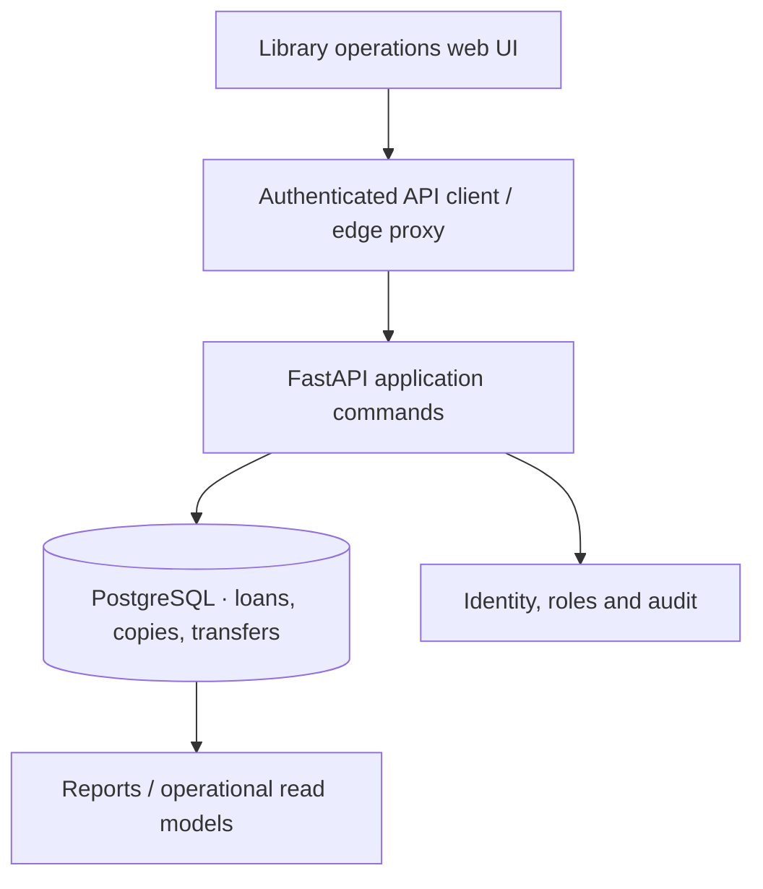

# Library Network — Product-first web application

Status: **owner-approved product goal / design target, not deployed implementation**.
Decision date: 2026-11-21 (Argentina).
Baseline: repository `main` `c2e8136428c07eaa57be1bfb44d5c692f8a3e8f7`.

## Product intent (persisted)

Build a credible **multi-branch library operations web application** that librarians and network coordinators could use, not a lecture about database transactions. The public recruiter experience should resemble a real product: discover books, manage copies, register checkouts/returns and transfers, inspect history and resolve conflicts. The corresponding [portfolio View Case](https://franvitar.genovasite.com/work/library-network-api) owns architecture diagrams, test evidence, tradeoffs, technical explanations and code links.

The currently hosted `showcase/` is a synthetic engineering simulator. **Do not delete it or its tests**; preserve it as QA/reference while a connected product interface is built and verified. Ultimately the public primary URL should open the operational app, not the 202/409 teaching scenario.

## Roles and useful work

| User | Workflows | Acceptance |
| --- | --- | --- |
| Branch librarian | Find a title/copy, issue loan, return copy, view due items and transfer status | Two realistic end-to-end loans/returns and a failed conflict path can be completed without code knowledge |
| Network operator | Request/route interlibrary loans, receive/depart transfers, resolve exceptions | A transfer moves through legal states and updates availability consistently |
| Branch manager | Maintain copies, inspect holds/overdue items and branch circulation | Actions are attributable and limited to branch permissions |
| Network admin | Manage branches, staff access, policies and reports | Cross-branch views are authorized and audit trails available |
| Reader (later optional) | Browse catalog, see own requests/loans | PII and another patron's records never leak |

## User-facing information architecture

- **Home/dashboard:** operational KPI cards with truthful counts, recent activity, pending arrivals and overdue queues, sensible empty states.
- **Catalog:** title/author/ISBN search, filters, edition details, branch availability and a book-detail view listing owned physical copies.
- **Circulation:** guided checkout/return flow, patron lookup, validation errors, receipt/status and clear due dates.
- **Transfers:** network requests, statuses, ship/receive handoff, idempotent retry and a visible conflict resolution path.
- **Patrons:** scoped records, current loans, holds and due notifications in test mode (no real notifications in public environment).
- **Operations:** stock/copy inventory, reports, staff roles, settings and audit activity.

Avoid prominent API status codes, `FOR UPDATE` explanations or architecture prose in normal product screens. Offer useful human error messages; keep backend trace IDs in a collapsible support/diagnostic view. A discreet `Datos de prueba` notice is appropriate in the public sandbox.

## Reuse map and gaps

| Existing source | Real capability | Planned work |
| --- | --- | --- |
| `app/api/routes.py`, `schemas.py` | FastAPI catalog, branches, copies, loan and transfer endpoints | Consume via typed frontend API client; extend contracts only when a workflow needs it |
| `app/application/request_loan.py`, `return_loan.py`, `activate_loan.py`, `advance_transfer.py` | Transactional circulation workflow and legal transitions | Reuse as canonical authority, avoid reimplementing rules in JS |
| `app/persistence/*`, Alembic schema | PostgreSQL relational data and constraints | Add patrons/search/holds/reporting only through tested migrations |
| `tests/integration/test_concurrency.py`, idempotency and lifecycle tests | Database-backed tests (prior 129-test checkpoint; independently recheck current CI) | Retain and extend role/auth, frontend/API and full browser scenarios |
| `showcase/` | Fictional browser-only concurrency simulator | Keep as technical/QA artifact until actual UI/API test environment is live |

**Critical gap:** the API source is explicitly a local unauthenticated demo (`app/api/routes.py`). Never expose this API publicly for anonymous mutations. Authentication, branch-scoped authorization, rate limits and visitor isolation are required before hosting a write-capable backend.

## Proposed architecture

- Frontend: accessible responsive operations UI, with real state from the API and navigable URLs; choose Next.js/React based on hosting cost and deployment fit when implementation starts.
- Backend: **preserve FastAPI/Postgres** and its transaction/locking/idempotency tests, not a reimplemented fake JS domain model.
- Auth: branch-scoped operators and least-privilege admin; server validates every mutation. Public read-only catalog may be anonymous, borrowing and member records cannot.
- Public evaluation: isolated seeded synthetic data, role-limited accounts, reset/reconcile, no actual patron PII or external communications. Prefer ephemeral test namespace if affordable; do not rely on shared client localStorage as the authoritative database.
- Hosting: frontend can use Vercel, but FastAPI and PostgreSQL need a suitable independently secured runtime/database. Provider/cost choice is **OPEN**, not assumed approved.

## Prioritization and Definition of Done

**P0** — actual catalog/branch/loan/return/transfer UI; API-connected isolated database; role gate; search and contextual errors; desktop/mobile accessibility; no anonymous write. **P1** — holds, due-date queues, transfer timeline, audit, patrons, reports/exports, test notifications and operational metrics. **P2** — barcode scanning, multi-institution policy engine, fine payments, third-party ILS protocols, live email/SMS, offline sync: research and implement only if justified.

Done when a first-time nontechnical visitor can complete realistic library workflows, see persisted resulting state, recover from conflicts and reset a scoped demo. Proven browser/API/database tests include simultaneous requests for one copy, duplicate idempotency key, invalid state transition, forbidden role access, failed dependency and restore. No real patron records, paid infra or protected production host are inferred as authorized.

## Next implementation gate

1. Characterize existing schemas and API contracts; inventory direct UI workflows.
2. Design role matrix, public sandbox lifecycle and operational UI, then choose minimal hosting for the **actual API**.
3. Implement one browser→API→Postgres vertical slice (search → loan → return) with integration tests before broad UI expansion.
4. Add transfer, patron and manager workflows; local CI and E2E prior to one bounded public deploy.
5. Update View Case to distinguish current code, public runtime and tests genuinely observed.

No live backend/auth/deployment change was executed when recording this product contract.
