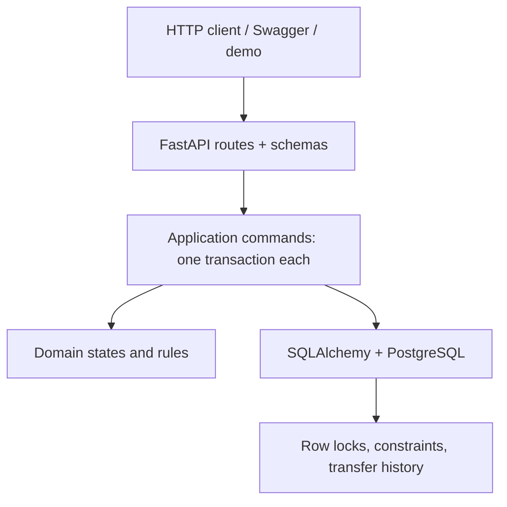

# Case study: reliable interlibrary lending under concurrency

> **Portfolio engineering lab — V1 on `main`.** The original academic implementation was an individual project by Francisco Vitar (owner-confirmed and consistent with repository history). This separate API was developed with AI assistance and is not a production service.

## The problem (30 seconds)

Two library branches share physical books. A member at one branch requests a copy owned by another; staff transfer it out, the member borrows it, and the copy eventually travels home. The tricky part is not listing books. It is keeping **one physical copy from being promised to two members**, including during the return journey and under simultaneous requests.

This project models that problem as a bounded REST API using FastAPI, SQLAlchemy 2, PostgreSQL 17, Alembic and Docker Compose. The real API remains local-only and unauthenticated; it must not be exposed publicly. A [separate interactive frontend](../showcase/) now explains its invariants with a deterministic browser model. That UI is not an HTTP client of the backend and cannot prove PostgreSQL transactions or concurrent locking. The [backend source](../README.md) remains runnable and inspectable locally.

## Role, ownership and provenance

- **Original academic project:** [tp-DAO](https://github.com/franciscovitar/tp-DAO) is the earlier Python/Tkinter/SQLite implementation. Francisco Vitar confirmed he developed that TP individually. The public history inspected for this review contains **72 commits and 14 pull requests**, all attributed to `franciscovitar`, with no declared co-authors. That corroborates the recorded GitHub contributions; it does **not** claim the work was done without development tools or AI assistance.
- **This portfolio API:** `library-network-api` is a separate FastAPI/PostgreSQL implementation informed by the academic **domain scenario**. A targeted comparison of four representative code-file pairs found no shared substantive code lines; that check is not a full provenance audit or a claim that the underlying domain ideas were invented from scratch.
- **AI-assisted delivery:** the owner defined and accepted the scope, architecture constraints and review decisions. ChatGPT assisted with planning, review and documentation; Claude Code assisted with implementation, tests and the local demo. Hosted CI provides observable behavior, not a substitute for demonstrating individual technical understanding in an interview.

## The engineering contract

The API must guarantee that:

1. A copy has at most one loan that is not terminal, even if two requests arrive together.
2. A request, its outward transfer, the initial history event and its idempotency record commit together—or none do.
3. The physical location changes **on transfer receipt**, not when dispatch starts.
4. Returning the book to the borrowing branch does **not** free it for another loan. The original loan closes only after return-transfer receipt at its owning branch.
5. A damaged return retires the copy instead of making it available.
6. Retrying a request with the same key and body does not create another loan; reusing the key for a different body is rejected.

The domain flow is deliberately small:

| Moment | Loan | Copy | Transfer |
|---|---|---|---|
| Request accepted | `REQUESTED` | `RESERVED` | Outward `PREPARED` |
| Dispatched | `REQUESTED` | `IN_TRANSIT` | Outward `DISPATCHED` / `IN_TRANSIT` |
| Received at borrowing branch | `REQUESTED` | `RESERVED` | Outward `RECEIVED` |
| Borrowing starts | `ACTIVE` | `ON_LOAN` | Outward complete |
| Borrower hands it back | `RETURNING` | `PENDING_RETURN` | Return `PREPARED` |
| Return travels home | `RETURNING` | `IN_TRANSIT` | Return `DISPATCHED` / `IN_TRANSIT` |
| Return received | `CLOSED` | `AVAILABLE` or `RETIRED` | Return `RECEIVED` |

## Architecture and key decisions



The structure is a **modular monolith**. Routes manage the HTTP contract and transaction boundary (`sessionmaker.begin()`); application functions implement one business command each; the domain names legal states and transitions; the database enforces integrity. A request never shares a SQLAlchemy session with another request.

Three decisions carry most of the reliability work:

**1. Serialize changes to the same physical copy.** Commands lock rows with PostgreSQL `SELECT ... FOR UPDATE` in a fixed order: idempotency claim (when applicable), copy, loan, transfer. After acquiring locks they re-read and validate state. That addresses races between a new request and an active/returning loan; the predictable order also reduces deadlock risk. See [ADR 0002](adr/0002-lifecycle-locking-idempotency.md) and [the locking code](../app/application/locks.py).

**2. Put a second integrity boundary in PostgreSQL.** A partial unique index allows only one nonterminal loan per copy, while permitting historical `CLOSED` loans:

```sql
CREATE UNIQUE INDEX uq_loans_copy_id_nonterminal ON loans (copy_id)
WHERE status IN ('REQUESTED', 'ACTIVE', 'RETURNING');
```

Named foreign keys, `CHECK` constraints and unique transfer-history events catch invalid data even if application validation regresses. The schema and trade-offs are recorded in [ADR 0001](adr/0001-relational-model.md) and the [reviewed migration](../alembic/versions/0001_initial_relational_model.py). This is **not** a performance benchmark or an `EXPLAIN ANALYZE` claim.

**3. Make retries safe without a cache service.** A PostgreSQL unique `(operation, key)` claim uses `INSERT ... ON CONFLICT DO NOTHING`. The claim references a preallocated loan ID through a **deferred foreign key**, so the key cannot commit without its loan. Same key + same canonical request body replays the resource (`200`); same key + different body returns `409`. Rejected requests roll the claim back. The cost is that PostgreSQL sequences can have gaps, which is normal and documented. See [request command](../app/application/request_loan.py).

The design intentionally avoids extra queues, distributed locks, Redis and microservices: the current V1 has one transactional database and no external side effects to coordinate.

## What the API demonstrates

The complete path is exposed at `/api/v1`: request an interlibrary loan, advance a transfer through legal transitions, activate the loan, register the borrower's return and advance the homeward transfer to close the loan. Read endpoints expose copies, loans, transfers and their history. Illegal transitions return stable error codes rather than partially updating records. The [README](../README.md#the-lifecycle) lists requests and state changes, and `/docs` serves generated OpenAPI locally.

A deterministic-sequence [demo script](../scripts/demo_scenario.py) asserts the whole round trip and includes **two concurrent requests for the same copy**: exactly one succeeds (`201`) and the other is rejected (`409`). It also checks replay, changed-body key reuse, illegal transitions, the copy remaining blocked during return, and final availability at its owner. A reused demo run ID is rejected before the script writes anything. Loan IDs are excluded from its normal success transcript because either competing request may obtain the first sequence value.

## Evidence, with its boundaries

| Verification | Observed result | Evidence |
|---|---|---|
| Real hosted CI | `success` on commit `efc06a3c777ca571130647796d29ed464512fd9b` | [GitHub Actions run #44441208480](https://github.com/franciscovitar/library-network-api/actions/runs/44441208480) |
| Python / database | Python 3.13.18, PostgreSQL 17 service, Ubuntu 24.04 | [CI job](https://github.com/franciscovitar/library-network-api/actions/runs/44441208480/job/135282200510) |
| Tests in hosted CI | **129 passed: 117 integration + 12 unit/HTTP; 0 skipped** | Same job's pytest output and JUnit report verification |
| Static checks | Ruff lint and format passed | Same CI job |
| Database-backed risk tests | Concurrency, rollback, migration, idempotency and state-machine tests ran within the 117 integration tests | [Test source](../tests/integration) and CI report |
| Additional local evidence | Docker Compose full-cycle run, repeated concurrency tests and manual mutation experiments | [README test record](../README.md#tests); reported by the local development executor, not independently repeated here |

The CI workflow sets `REQUIRE_INTEGRATION_TESTS=1`. Its pytest hook fails if the database is missing or tests are skipped; an independent [JUnit checker](../scripts/ci/check_test_report.py) rejects any skip or fewer than 100 successful integration tests. The **passing** path is verified in the linked hosted run. Deliberate failure cases for these guards were exercised locally, **not** in a separate hosted run. No performance or availability SLA is claimed.

### Reproduce locally

Prerequisite: Docker Desktop or Docker Engine with Compose, plus Python to invoke the demo script.

```bash
docker compose up --build -d
docker compose run --rm api python -m app.persistence.seed
python scripts/demo_scenario.py --run-id portfolio-demo-1
```

Expected final assertion: `DEMO OK: complete loan cycle verified`. Use a **new** `--run-id` on subsequent executions. The service listens on `127.0.0.1:8000`; PostgreSQL has no published host port. Full test setup and teardown commands are in the [README](../README.md#tests).

## Honest trade-offs and next work

- **Local demo, not production:** write endpoints have **no authentication or rate limiting**; never expose them as a public hosted service without a separate security design.
- **Deliberately bounded domain:** no cancellation of abandoned requests, no reinstatement of retired copies, fixed 14-day loan period, no renewals or fines.
- **Verification limits:** successful GitHub Actions CI is linked above; no deliberate hosted CI failure, `actionlint` invocation, load/performance benchmark or production incident evidence. The Swagger specification is tested, but visual review of Swagger UI was not recorded.
- **CI policy:** runs on pull requests; it is not currently a required protected-branch check.
- **Claim boundary:** original-TP individual authorship is supported by owner confirmation and GitHub's recorded contributor history; the new API is explicitly AI-assisted. Before using this case to claim personal mastery in interviews, the owner should be able to independently explain and reproduce the transaction, lock-order and failure-handling decisions. This artifact does not establish unaided coding proficiency.

**Takeaway:** the result is a small backend whose interesting property is *consistency under competing writes*, supported by inspectable database constraints, explicit transaction boundaries, reproducible tests and publicly linked CI results—not a claim of production readiness or business adoption.
