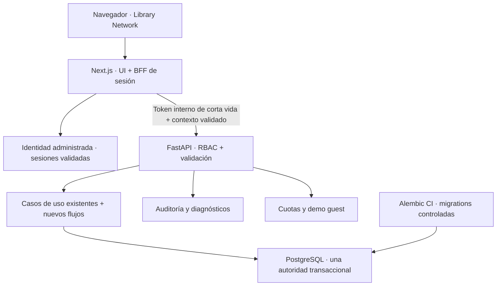

# Library Network — Product & Architecture Blueprint

**Fecha:** 23 de noviembre de 2026 (Argentina)  
**Estado:** DRAFT / RESEARCHED DESIGN / NO IMPLEMENTADO / SIN AUTORIZACIÓN DE DESPLIEGUE  
**Producto:** aplicación operativa para redes de bibliotecas, no simulador didáctico.  
**Proyecto canónico:** `franciscovitar/library-network-api`, `main` `0f583edf3a4d80cb05acc99237d2a432b8302abf`.  
**PAS:** `franciscovitar/personal-ai-system`, `main` `91468744e483bff467f7016c0a880321486a3628`.  
**Ruta Genova:** `software-modernization + IMPROVE`, complementos UX, API/integraciones, seguridad, QA. **Authority:** `NONE` para mutaciones externas; contenido de este archivo: propuesta.

## 1. Tesis de producto

Convertir el backend existente de préstamos interbibliotecarios en una **plataforma operativa multipunto**, con catálogo, circulación local/interbibliotecaria, ejemplares, socios, transferencias, reservas, reportes y trazabilidad. La aplicación debe resolver tareas reales con persistencia real y ofrecer una **demo pública segura** con datos enteramente sintéticos pero operaciones auténticas. La ficha del portfolio es la encargada de explicar la arquitectura, las pruebas y decisiones, no la aplicación.

**Diferenciación:** un sistema de uso diario, veloz, legible, con interacción fluida y experiencia de primera categoría, especialmente en traspasos entre sucursales. No prometer reemplazar Koha o FOLIO en compras, catálogo MARC, multas complejas, integración ILS, e-resources y todas sus demás funciones.

**Acotación de “100% funcional”:** el producto cumple de extremo a extremo TODOS los flujos comprometidos en su versión (sin botones decorativos ni estados ficticios). No significa paridad funcional con todas las plataformas bibliotecarias del mundo ni certificación institucional sin pilotos y QA real.

## 2. Base verificada en GitHub

| Capacidad | Hecho observado | Estado |
|---|---|---|
| FastAPI + SQLAlchemy + PostgreSQL | Existe API local y modelo relacional con Alembic | Implementado en código, no desplegado públicamente |
| Préstamo **entre sucursales** | REQUESTED → transfer OUTBOUND → ACTIVE → RETURNING → transfer RETURN → CLOSED | Implementado |
| Concurrencia | `SELECT ... FOR UPDATE`, índice único parcial de préstamo no terminal por ejemplar, transacciones | Implementado, tests de integración presentes |
| Idempotencia | `Idempotency-Key`, hash canónico y claims atómicos | Implementado para solicitud interbibliotecaria |
| Catálogo | GET de libros paginado, sucursales y detalle individual de ejemplares | Básico: sin búsqueda, filtros, gestión |
| Socios | `Member` con código y `enabled` sintéticos | Sin fichas de socios reales, roles ni privacidad operativa |
| Préstamo **local** | `loans` obliga `origin_branch_id <> destination_branch_id` | NO IMPLEMENTADO: requiere nuevo caso de uso y migración revisada |
| Seguridad y roles | API declara que es local y no autenticada | NO IMPLEMENTADO; bloqueante para publicación con mutaciones |
| Web de muestra | `showcase/` ejecuta un modelo JavaScript enteramente en memoria | No es el producto real |

Identidad de fuentes: `docs/PRODUCT_DIRECTION_V2.md` blob `382ef44876541ce20948f0e1403ffa04e198227c`; `app/api/routes.py` `0ceb049a9a4b6251f7d73c5a4e8f2c6202c97528`; `app/persistence/models.py` `a655e2281796e57abea11d6f6ec8913422b56e7d`; `app/application/request_loan.py` `ff512d5bba9f83c61e74271fb09cff6fcb6361b2`; `app/application/return_loan.py` `94e53f2cb8ca693d0397e97629259280ea212917`; `app/domain/rules.py` `edeb572f081f4cb1fab2b22a1b3fa1da1148b664`. Los resultados de 129 pruebas son checkpoint HISTÓRICO documentado; no se ejecutaron pruebas nuevas para este blueprint.

## 3. Benchmark externo — qué copiar como principio, no como apariencia

| Referente | Patrón observado | Adopción contextual | Lo que no copiaremos |
|---|---|---|---|
| [Koha, circulación](https://koha-community.org/manual/24.05/en/html/circulation.html) | Acceso inmediato a check-out, check-in, búsqueda de socio/barcode, avisos de transferencias | Entrada rápida, formulario centrado en tarea, barcode y estado legible | Pantallas históricas densas sin jerarquía |
| [FOLIO](https://folio.org/platform/features/) | Módulos para circulación, inventario, solicitudes, usuarios y políticas | Navegación modular y modelo de roles/políticas | Reconstruir una suite ILS universitaria enorme |
| [Evergreen, reservas](https://docs.evergreen-ils.org/docs/latest/circulation/basic_holds.html) | Reserva y recogida entre sucursales, colas y estados | Estados explícitos, origen y lugar de recogida siempre visibles | Complejidad de política no pedida |
| [NN/g, data tables](https://www.nngroup.com/articles/data-tables/) | Encontrar, comparar, editar y accionar sobre registros | Tablas operativas para préstamos, ejemplares y traslados | Todo convertido en tarjetas de marketing |
| [WCAG 2.2](https://www.w3.org/TR/wcag/) | Accesibilidad de formularios, foco, estados y controles | Objetivo AA verificable mediante pruebas automáticas y manuales | Animaciones que distraen y dificultan operación |

**Propuesta de diseño:** «Biblioteca contemporánea + software B2B de precisión». Identidad cálida y editorial, pero superficie de trabajo utilitaria. Títulos editoriales acotados, tablas de alta calidad, buenos controles por teclado y cero animaciones que bloqueen tareas.

## 4. Dirección de UI/UX

**Nombre de producto:** `Library Network` (sin “API” visible al usuario final). Idioma base español; catálogo internacionalizable más adelante.

**Paleta propuesta — a contrastar:** ink `#172C2B`, pine `#1F6054`, warm canvas `#F7F6F1`, white `#FFFFFF`, slate `#536461`, border `#E4E7E1`, amber `#B76B38` (alerta), red `#A43C3C` (peligro), pale sage `#DDEBE6` (éxito). No usar color como única señal de estado. Validar contrastes con tokens definitivos; no se afirma conformidad actual.

**Tipografía:** sans legible para aplicación y números (Inter o Geist, licencia por verificar); serif discreta para títulos grandes de bienvenida (Newsreader, licencia y render por verificar). Tablas usan números alineados, fechas explícitas y estados con texto.

**Layout escritorio:** sidebar ~236 px, encabezado superior ~64 px, contenido máximo de ~1440 px, grilla de 12 columnas; acciones operativas permanecen accesibles. **Tablet:** navegación colapsable; **móvil:** navegación priorizada, tablas convertidas en filas bien etiquetadas o scroll accesible. Sin hover obligatorio ni contenido que aparezca solo al pasar el mouse.

**Ritmo visual:** superficies neutras, componentes precisos, badges de estado, sombra muy sutil, transiciones de 120–180 ms solo para feedback; soporte `prefers-reduced-motion`. Fotos de tapas opcionales, no bloquean funciones. Evitar la apariencia de un template genérico con KPIs ficticios.

### 4.1 Navegación real

- **Resumen:** tareas pendientes y accesos rápidos.
- **Catálogo:** títulos, autores, ISBN, ejemplares, sedes, disponibilidad y edición.
- **Circulación:** prestar, devolver, renovar (si la política lo habilita), historial, vencimientos.
- **Transferencias:** preparar, despachar, tránsito, recepción, excepciones.
- **Reservas:** pedidos por título/ejemplar y cola de retiro, después de implementar el caso de uso.
- **Socios:** alta, estado, préstamos abiertos y vencidos; proteger PII.
- **Sucursales:** disponibilidad por sede, personal y configuración de alcance.
- **Informes:** circulación, transferencias, atrasos, exportaciones autorizadas.
- **Administración:** roles, reglas, auditoría, retención y salud.

### 4.2 Pantallas insignia

**Resumen / Centro de operaciones**

```text
Library Network   [Buscar libro, socio o código... Ctrl+K]    [Sucursal: Centro v] [Cuenta]
------------------------------------------------------------------------------------
Catálogo             BUEN DÍA · SUCURSAL CENTRO
Circulación          Tu biblioteca, al día.                  [+ Registrar préstamo]
  Prestar            [Activos] [Vencen hoy] [Por recibir] [Reservas listas]
  Devolver
Transferencias       PRIORIDAD DE HOY                    ACTIVIDAD RECIENTE
Reservas             5 traslados por recibir                Evento | Hora | Usuario
Socios               3 préstamos vencidos                  ...    | ...  | ...
Informes             2 reservas para retiro
Configuración        [Ver cola de trabajo]
                     [Prestar un libro] [Registrar devolución] [Enviar traslado]

                     PRÉSTAMOS RECIENTES
                     Socio    | Libro     | Sucursal | Vencimiento | Estado | Acción
```

**Catálogo:** barra de búsqueda persistente por título/autor/ISBN/código; filtros de sucursal, estado y categoría; vista compacta de tabla (staff) y miniaturas (opcional). Detalle de libro incluye fichas de ejemplares separados por sede, incluyendo **sede propietaria** y **ubicación actual**. No confundir ejemplar `RESERVED` con `AVAILABLE`.

**Circulación:** flujo operativo optimizado de dos pasos: identificar socio → escanear o buscar ejemplar → confirmar. Debe resolver en tiempo real conflictos de disponibilidad, rol, políticas o expiración. La confirmación viene del servidor; UI nunca decrementa inventario a ciegas. La devolución local y la devolución de un préstamo interbibliotecario son flujos diferentes, claramente rotulados.

**Transferencias:** lista con estados y origen/destino; detalle en línea de tiempo `Preparado → Despachado → En tránsito → Recibido`; solo botones de transición válidos y autorizados. Un libro en tránsito NO está disponible. Cambiar sede de destino nunca equivale a marcar recepción.

**Socios/Reservas:** fichas acotadas con información necesaria, permisos restrictivos y trazas de cambios. No reutilizar el modelo `Member` sintético como si ya gestionara datos reales.

### 4.3 UX profesional

- Barra de búsqueda global y búsqueda contextual; resultado y selección por teclado.
- Formularios que conservan entradas ante errores, etiquetas explícitas y mensajes vinculados a los campos.
- Estados de carga con skeleton solo para datos, empty states útiles y error con opción de reintento sin prometer éxito.
- Acciones peligrosas con confirmación proporcional, motivos y auditoría; no modales para todo.
- Status con nombre, momento y último evento; accesibilidad del feedback con regiones `aria-live` donde corresponda.
- Indicador discreto «Entorno de prueba · datos ficticios» en la demo pública.
- Sin dashboard vacío inflado con métricas inventadas: mostrar datos reales o un estado vacío.

## 5. Arquitectura objetivo



**Frontend:** Next.js + React + TypeScript (App Router) en Vercel; formularios accesibles y componentes propios construidos sobre primitives contrastadas. Evaluar shadcn/ui + TanStack Table para tablas, filtros, paginación **servidor** y selección; no adoptar versión mayor sin spike y tests. FastAPI publica OpenAPI para generar tipos TypeScript y tests de contrato. El frontend no replica reglas de préstamos ni mutaciones de inventario.

**BFF:** sesiones HttpOnly, protección CSRF de mutaciones, rate limit y antifraude, mapeo de usuario real/guest; envía a FastAPI una identidad verificable y de corta vida. FastAPI valida firma y permisos, no acepta cabeceras arbitrarias `x-role`. En las rutas de préstamos resuelve organización, sede y permiso por cada identificador, no solo por botón visible.

**Backend:** se conserva `app/application/*` y SQLAlchemy. Añadir módulos de `authorization`, `catalog`, `circulation/local`, `holds`, `staff`, `reporting`, `audit`. Alembic secuenciado y pruebas de regresión por migración, sin `create_all` en producción.

**PostgreSQL:** conexión agrupada para serverless con transacciones breves; migraciones y herramientas administrativas por conexión directa. Neon es candidato de infraestructura con límites de plan; comparar y probar contra despliegue antes de adoptar. No hacer requests al proveedor por cada fila. No exponer la base al navegador.

**Operación:** salud y readiness separadas; logs correlacionables sin PII, backup restaurable y restore drill, entornos DB demo/producción separados. No almacenar secretos en GitHub o en clientes JavaScript.

### 5.1 Alternativas de deploy (todavía no adoptadas)

| Alternativa | Ventaja | Riesgos y validación |
|---|---|---|
| Vercel Next.js + Vercel FastAPI (dos proyectos) + PostgreSQL gestionado | Aislamiento, despliegue independiente, Python nativo GA | Probar auth, latencia, conexiones, límites y costo; aumenta coordinación de releases |
| Vercel Services Next.js/FastAPI (un proyecto) + PostgreSQL | Un dominio, monorepo y routing consistente | Services sigue en **beta**; probar build, logs, rollback, aislamiento antes de elegir |
| Next.js Vercel + API Docker siempre activa + PostgreSQL | Control del proceso y más opciones para jobs | Costo operativo, parches/observabilidad adicionales; innecesario sin carga real |

**Preferencia inicial:** dos proyectos Vercel aislados y PostgreSQL gestionado, sujetos a un spike backend+DB+Auth. Services pasa a preferida solo si se prueba que mejora simplicidad y tiene rollback comparable. Como el core es sincrónico, no hay requisito actual de worker permanentemente activo.

**Costos:** Neon anunciaba en noviembre de 2026 Free hasta ciertos límites (`100 CU-h`, `1 GB`, `5 GB transferencia` por proyecto y suspensión por cuota), **no es una garantía de uso sin costo** ni autorización para excedentes. Mantener alertas, hard caps y presupuesto declarado antes de deploy. Revisar plan real y disponibilidad de recursos en el momento. Más información: https://neon.com/docs/introduction/plans y https://neon.com/docs/connect/connection-pooling .

### 5.2 Autenticación y demo pública

Separar conceptualmente:

1. **Usuarios reales de organizaciones autorizadas:** sesiones gestionadas con una librería/proveedor probado (candidatos Auth.js OAuth/email o Managed Better Auth de Neon). Roles almacenados en nuestro dominio; nunca los declara la interfaz.
2. **Demo para reclutadores:** botón `Explorar demo` crea un workspace de **datos ficticios** con rol `DEMO_OPERATOR`, cookie HttpOnly breve, cuota estricta de escrituras/consulta, dataset propio y vencimiento. Todos los flujos funcionan contra el backend real. Desactivar envíos externos, eliminar datos vencidos y limitar altas para evitar abuse/costos.
3. **Entornos de datos distintos:** demo pública jamás toca la DB o las credenciales de un eventual cliente. En fase inicial, también es aceptable operar con workspace demo fijo **solo en Preview privado**; no habilitar writes anónimas en público hasta completar aislamiento.

Para no duplicar esfuerzos, modelar organization/branch membership correctamente desde el principio. `organization_id` y `branch_id` se verifican server-side en todas las consultas y mutaciones; el modelo de tenant no es solo un filtro visual. Evitar compartir un dataset mutable entre visitantes sin controles de interferencia.

## 6. Evolución del dominio y las migraciones

**Conservar** `Branch`, `Member`, `Book`, `Copy`, `Loan`, `Transfer`, `TransferEvent`, `IdempotencyRecord`. Introducir *con migraciones pequeñas y pruebas*:

- `Organization`, `OrganizationMembership`, `StaffUser`/identity mapping, `BranchGrant`, `AuditEvent`, `DemoWorkspace`.
- `Book` metadata opcional (edición/fecha/idioma/categoría/cover_ref); `Copy` código/estado/sede propietario/ubicación actual, jamás un boolean `available` duplicado.
- `Member` ampliado a socio con atributos mínimos, permisos de acceso, redacción y política de borrado. Para demo, datos ficticios solamente.
- **Préstamo local:** decisión de ADR: agregar `Loan.kind=LOCAL|INTERLIBRARY` y reemplazar el CHECK de sedes por una regla condicional (`LOCAL` misma sede sin transferencias, `INTERLIBRARY` sedes distintas con transferencias), manteniendo los tests de invariantes anteriores. Prototipar esto antes de migrar: quizá subtipos separados resulten más seguros si las políticas divergen.
- `Hold` con cola, lugar de retiro, plazos y prioridad de asignación; evitar reservas falsas que no bloquean stock realmente.
- `CirculationPolicy`/`RenewalEvent` para reglas auditables, vencimientos y renovaciones.
- `OperationalEvent`/`Outbox` solo si hay notificaciones o procesos asíncronos reales; NO agregar cola prematuramente.
- Para multi-organización, plan de backfill, claves compuestas o validaciones con FKs tenant-scoped y pruebas de consultas cruzadas; nunca cambiar restricciones globales sin revisar su alcance.

**Aspecto crítico:** el esquema actual obliga `loans.origin_branch_id <> loans.destination_branch_id` y `transfers.origin_branch_id <> ...`. Un préstamo dentro de la misma sucursal no se implementa cambiando arbitrariamente IDs en la UI: requiere evolución formal del dominio.

## 7. Contratos API, estados y UX

Los endpoints actuales `/api/v1/loans/interlibrary`, `/api/v1/transfers/{id}/transitions`, `/api/v1/loans/{id}/activate`, `/api/v1/loans/{id}/return` se preservan en compatibilidad. Nuevas rutas recomendadas tras tests de contrato (borrador, NO existentes):

```text
GET  /api/v1/catalog/search?q=&branch_id=&status=&cursor=
GET  /api/v1/books/{id}/copies
GET  /api/v1/circulation/loans?status=&branch_id=&cursor=
POST /api/v1/circulation/local-loans         + Idempotency-Key
POST /api/v1/circulation/local-returns       + Idempotency-Key
GET  /api/v1/transfers?status=&direction=&branch_id=
GET  /api/v1/operations/summary
GET  /api/v1/members/{id}                    (autorización de campo y objeto)
POST /api/v1/holds                           (cuando implementado)
GET  /api/v1/audit-events                    (roles autorizados)
```

Para el frontend, el servidor debe emitir errores estructurados: `code`, `message`, `field_errors`, `request_id`, y nunca SQL/PII. Un HTTP `409` por ejemplar reservado se convierte en «Este ejemplar acaba de reservarse en otra sucursal. Elegí otro ejemplar» + acción útil. Mantener internacionalización posible y semántica de estado veraz.

## 8. Matriz de roles (borrador)

| Operación | Público catálogo | Demo operator | Bibliotecario de sede | Coordinador | Admin red |
|---|---|---|---|---|---|
| Consultar catálogo público | Sí | Sí | Sí | Sí | Sí |
| Ver datos de socios | No | Solo sintéticos del workspace | Solo alcance autorizado | Según función | Según función |
| Préstamo/devolución | No | Solo workspace demo | Solo sede habilitada | Según función | Según función |
| Despachar/recibir traslado | No | Solo demo | Solo con permiso de sede | Sí, dentro de red | Sí |
| Editar inventario | No | Limitado a demo cuando se habilite | Según rol | Según rol | Sí |
| Gestionar personal y políticas | No | No | No | Limitado | Sí |
| Consultar auditoría | No | Historial demo seguro | Propia sede | Red autorizada | Red autorizada |

**Seguridad:** aplicar control en cada objeto y registro, no confiar en roles del frontend. OWASP API1:2023 destaca BOLA como riesgo crítico. Aislamiento de organizaciones y pruebas negativas deben bloquear publicación. Datos de socios reales solo en despliegue privado aprobado, con retención y contratos adecuados.

## 9. QA y aceptación — casos vinculados a requisitos

| ID | Camino / riesgo | Evidencia exigida |
|---|---|---|
| LN-E2E-01 | Staff encuentra socio y ejemplar, presta localmente, devuelve | Browser → API → DB, prueba automatizada + readback |
| LN-E2E-02 | Préstamo interbibliotecario completo, OUTBOUND/RETURN | Estados exactos y ubicación real con DB inspeccionada |
| LN-E2E-03 | Dos operadores disputan un mismo ejemplar | Solo una reserva/loan activa, sin efecto duplicado |
| LN-E2E-04 | Reintento con misma key y con payload alterado | Replay correcto / `409` sin segunda operación |
| LN-E2E-05 | Rechazos de transición fuera de orden | `409` y DB sin cambios |
| LN-SEC-01 | Bibliotecario intenta mutar otra sede | `403`, sin cambios |
| LN-SEC-02 | Usuario demo intenta leer otro workspace u organización | Denegado (sin enumeración ni fuga de PII) |
| LN-SEC-03 | CSRF, cookie caducada, URL maliciosa, cuota excedida | Denegaciones predecibles, sin writes |
| LN-DATA-01 | Migración hacia préstamo LOCAL | Up/down/forward-compatible y preservación de 129-checkpoint histórico; recuento y checks |
| LN-OPS-01 | Caída PostgreSQL / cuota agotada / restauración | Fallo visible, sin datos ficticios silenciosos, restore drill |
| LN-UX-01 | Operaciones teclado, lector de pantalla, 200% zoom y móvil | Evaluación manual WCAG 2.2 AA + automáticas |
| LN-UX-02 | Estados vacíos, lento, conflicto y error | Pruebas de usabilidad y visual regression |
| LN-LAUNCH-01 | Público ve solo datos demo; portfolio enlaza la app real | Smoke anónimo, sesión demo, autenticación staff, aislamiento, SEO |

Las pruebas futuras NO se consideran ejecutadas. Los 129 tests documentados en el proyecto son la baseline histórica, no prueba de este diseño. Integrar E2E Playwright solo cuando exista UI real; no llamar PASS a un documento de plan.

## 10. Plan secuenciado (sin plazos ni despliegues autorizados)

**Fase A — diseño y contrato:** inventario de endpoints y migraciones, user journeys, wireframes desktop/mobile, roles, ADR de préstamo LOCAL, criterio de búsqueda, presupuesto hard cap, elección de auth y aislamiento.

**Fase B — slice real local:** FastAPI protegido + PostgreSQL de test + Next.js; flujo buscar → préstamo LOCAL → devolver; prueba de UI/API/DB, de permisos y de migración.

**Fase C — producto multipunto:** transferencias completas y auditable, ejemplares, gestión de socios/sedes, reservas y vencimientos; dashboard alimentado por queries reales, reportes y permisos.

**Fase D — demo pública segura:** dataset por visitante o workspace seguro, sesiones y cuota, readback, aislamiento real, ataques simulados, cleanup, observabilidad y restauración; aprobación específica antes de deploy externo.

**Fase E — portfolio:** reemplazar el enlace al `showcase/` por la aplicación real; capturas de pantallas auténticas; case study técnico con SHA, tests y límites. Conservar el showcase anterior como QA interno/histórico.

**Definition of Done:** ninguna funcionalidad anunciada termina en un modelo browser-only; todos los principales flujos persisten; sin pagos ni notificaciones reales no justificadas; permisos/tenant/estado verificados en backend; escenarios negativos y rollback pasan; demo usable sin asistencia, accesible, con resultados observables; alerta/restore/runtime configurados. Producción institucional con datos reales se evalúa aparte tras un piloto autorizado.

## 11. Decisiones pendientes que sí requieren prueba, no intuición

1. ¿Un solo cliente/red de bibliotecas o varias organizaciones privadas reales? Propuesta: arquitectura preparada para organizaciones y demo aislada; no comercialización SaaS multi-tenant por defecto.
2. ¿Google/email managed auth con Auth.js o Managed Better Auth de Neon? Spike acotado con sesión, firma y rol; comparar mantenimiento, costo y aislamiento.
3. ¿Dos proyectos Vercel o Services beta? Spike con la misma API y DB; comparar latencia, rollback, logs y costo.
4. ¿Demo por workspace personal? Preferida para la experiencia recruiter, pero su costo de seed, limpieza y límites debe medirse antes de publicar.
5. ¿Semántica de préstamo local vs interbibliotecario? ADR con tests de contrato e invariantes anteriores.
6. ¿Se requieren datos y workflows reales de instituciones? No se cargan hasta evaluar permisos, privacidad, contrato y operación.

## 12. Fuentes externas y fecha de consulta

Consulta del 23/11/2026. Investigación documental — no son pruebas de implementación:

- Koha Staff Circulation: https://koha-community.org/manual/24.05/en/html/circulation.html
- FOLIO Features: https://folio.org/platform/features/
- Evergreen Holds: https://docs.evergreen-ils.org/docs/latest/circulation/basic_holds.html
- NN/g data tables: https://www.nngroup.com/articles/data-tables/
- WCAG 2.2: https://www.w3.org/TR/wcag/
- OWASP BOLA: https://api-security.owasp.org/editions/2023/en/0xa1-broken-object-level-authorization/
- OWASP ASVS: https://asvs.owasp.org/
- Vercel Python GA (15/10/2026): https://vercel.com/changelog/python-on-vercel-is-now-generally-available
- Vercel FastAPI: https://vercel.com/docs/frameworks/backend/fastapi
- Vercel Services Beta: https://vercel.com/docs/services
- Neon Free plan: https://neon.com/docs/introduction/plans
- Neon connections: https://neon.com/docs/connect/connection-pooling
- Neon Managed Better Auth (noviembre 2026): https://neon.com/blog/managed-better-auth-oauth-provider-mcp
- Auth.js: https://authjs.dev/getting-started
- shadcn Data Table: https://ui.shadcn.com/docs/components/base/data-table
- TanStack Table: https://tanstack.com/table/latest/docs/overview
- openapi-typescript: https://openapi-ts.dev/introduction

**No se adoptaron ni instalaron dependencias nuevas. No se publicaron recursos. Research First revisado para esta propuesta; métricas de UX, costo, rendimiento, disponibilidad y seguridad siguen `NOT_TESTED`.**